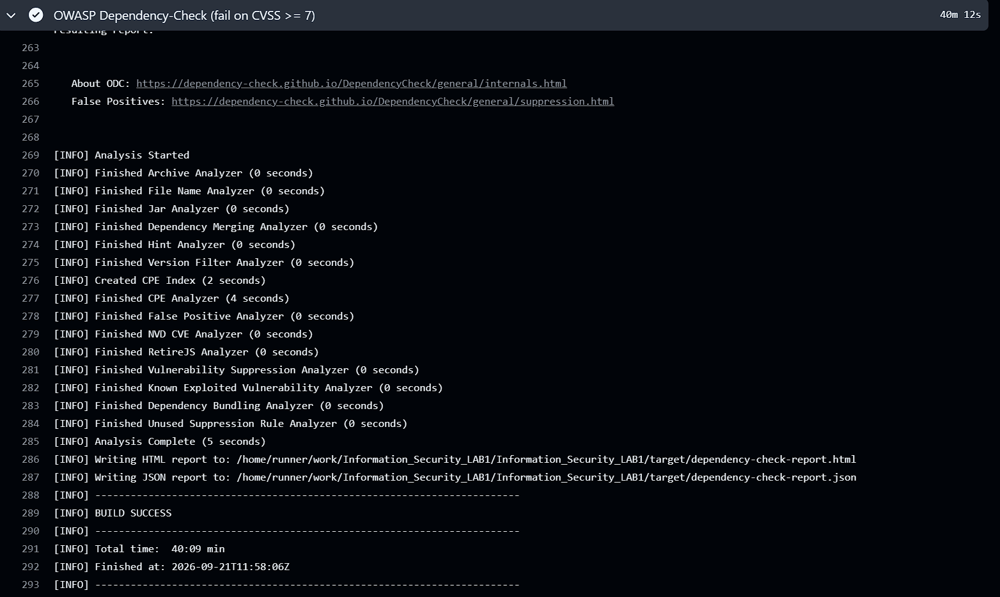
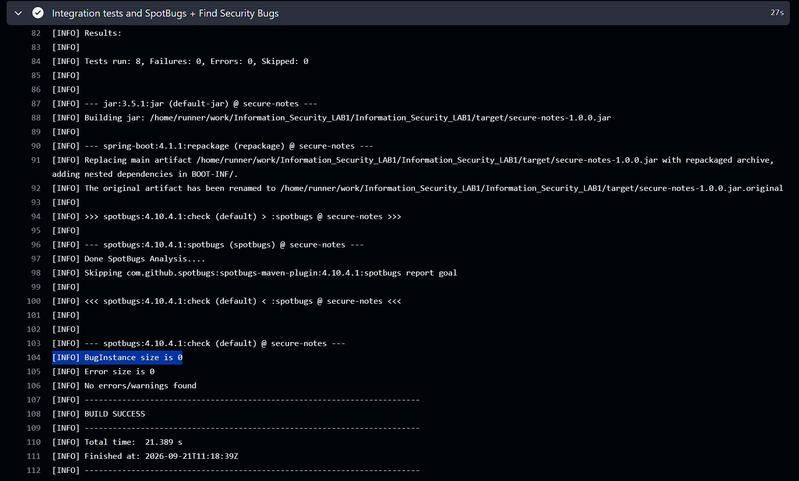

# Информационная безопасность

## Лабораторная работа №1

Защищённое REST API личных заметок: вход, создание записей и получение только своих данных.

### Стек

- Java 21 / Spring Boot 4.1.1;
- Spring Security, JWT, BCrypt;
- Spring JDBC (`JdbcClient`), PostgreSQL 17, Flyway;
- Maven, Docker Compose;
- GitHub Actions, SpotBugs + Find Security Bugs, OWASP Dependency-Check.

### Описание API

**`POST /auth/login`** — аутентификация пользователя по логину и паролю.
Тело запроса передаётся с `Content-Type: application/json`:

```json
{
  "username": "student",
  "password": "<BOOTSTRAP_PASSWORD из .env>"
}
```

Успех — `200 OK` и JWT, действующий 15 минут:

```json
{
  "accessToken": "<JWT>",
  "tokenType": "Bearer",
  "expiresIn": 900
}
```

Неверные реквизиты дают `401 Unauthorized`.

**`GET /api/data`** — получение заметок текущего пользователя.
Доступ только с JWT в заголовке:

```http
GET /api/data?limit=20
Authorization: Bearer <JWT>
```

Ответ — `200 OK` и массив заметок. `limit` ограничен диапазоном 1–100;
для следующей страницы можно передать `before=<id последней заметки>`.
Без токена или с недействительным токеном возвращается `401 Unauthorized`.

**`POST /api/data`** — создание заметки. Требуются `Authorization: Bearer <JWT>`
и `Content-Type: application/json`:

```json
{
  "title": "Первая заметка",
  "content": "Изучаю безопасность API"
}
```

Ответ — `201 Created` с полями `id`, `title`, `content`, `createdAt`.
Заголовок ограничен 120 символами, содержимое — 2000. Владелец определяется
сервером из JWT, а не из тела запроса.

### Описание реализованных мер защиты

**SQLi.** Все запросы выполняются через `JdbcClient` с параметрами.
Пользовательские значения не конкатенируются с SQL:

```java
return jdbc.sql("SELECT id, username, password_hash FROM app_users WHERE username = :username")
        .param("username", username).query(User.class).optional();
```

**XSS.** Заголовок и содержимое заметки экранируются при формировании ответа
с помощью `HtmlUtils.htmlEscape`. В БД хранится исходный текст:

```java
return new NoteResponse(note.id(), HtmlUtils.htmlEscape(note.title(), "UTF-8"),
        HtmlUtils.htmlEscape(note.content(), "UTF-8"), note.createdAt());
```

Например, `<script>alert(1)</script>` возвращается как
`&lt;script&gt;alert(1)&lt;/script&gt;`. Ответы имеют тип `application/json`;
дополнительно настроены `nosniff`, Content Security Policy и запрет встраивания во frame.

**Аутентификация.** Пароли хэшируются BCrypt с cost 12 и индивидуальной солью:

```java
PasswordEncoder passwordEncoder() { return new BCryptPasswordEncoder(12); }
```

При входе пароль проверяется через `PasswordEncoder.matches`, после чего выдаётся
JWT HS256. Ключ подписи берётся из переменной окружения. Spring Security проверяет
подпись, алгоритм, срок действия, issuer, audience и идентификатор пользователя
на обоих защищённых эндпоинтах. Сессии и cookie-аутентификация не используются.

**Контроль доступа и валидация.** Записи выбираются по `owner_id` из проверенного JWT.
Bean Validation ограничивает поля, неизвестные JSON-поля отклоняются.
Вход ограничен 10 попытками с IP за календарную минуту, тело POST — 16 КиБ.
Ошибки не раскрывают SQL и stack trace.

### Отчёты из pipeline

[Успешный запуск Security CI для коммита `89b94ff`](https://github.com/DeminGit/Information_Security_LAB1/actions/runs/35593275613).


**Dependency-Check (SCA):**



**SpotBugs + Find Security Bugs (SAST):**


